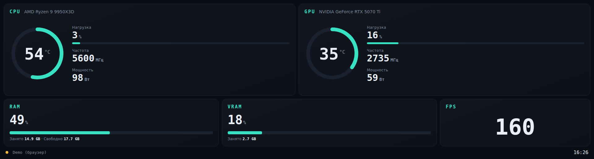

# PC HUD

Лёгкий монитор железа для второго (портативного) экрана. Берёт показания с
**HWiNFO** или **LibreHardwareMonitor** и рисует их в отдельном окне-приложении —
это не виджет на рабочем столе и не сайт в браузере, а обычное окно.



## Возможности

- CPU и GPU: температура (круговая шкала), нагрузка, частота, мощность.
- RAM, VRAM, FPS.
- Два источника данных с автовыбором: HWiNFO → LibreHardwareMonitor → демо.
- Цветовое кодирование: спокойный → янтарный → красный по мере роста нагрузки/температуры.
- Кросс-машинность: датчики ищутся по типу и ключевым словам, а не по точным именам,
  поэтому работает и на Intel/Radeon, не только на конкретной сборке.
- Один `.exe`, не требует установленного Python у конечного пользователя.

## Быстрый старт (готовый .exe)

1. Включите источник данных (любой из двух):
   - **HWiNFO** (рекомендуется): Settings → Main Settings → поставить галку
     **Shared Memory Support**. Оставить HWiNFO запущенным.
   - **LibreHardwareMonitor**: Options → **Remote Web Server** → Run (порт 8085).
2. Запустите `PC-HUD.exe`.
3. Окно перетащите на портативный экран и разверните.

Программа сама выберет доступный источник. Если ни один не найден — покажет демо-данные
и подскажет, что включить.

## Запуск из исходников

```bash
pip install -r requirements.txt
python -m backend.main                 # окно
python -m backend.main --fullscreen    # на весь экран
python -m backend.main --demo          # демо-данные (для проверки без железа)
python -m backend.main --list          # вывести все датчики и распознанные метрики
```

## Источники данных и античиты

Важно, если вы играете в игры с агрессивными античитами (Valorant/Vanguard, EAC, BattlEye):

- **HWiNFO** только читает уже опубликованные данные из общей памяти. Программа PC HUD
  ничего не внедряет в игры и не трогает их память — она лишь читатель. Это безопасный путь.
- **LibreHardwareMonitor** для доступа к датчикам поднимает kernel-драйвер (`WinRing0`).
  Такой драйвер исторически вызывает вопросы у некоторых античитов. Сам PC HUD при этом
  читает данные LHM по HTTP и драйвер в свой процесс не грузит — но если вы запускаете
  игру с жёстким античитом, надёжнее использовать **HWiNFO** как источник.

По умолчанию приоритет отдан HWiNFO именно по этой причине. Зафиксировать источник
можно в `config.json` полем `"source": "hwinfo"`.

## Настройка под свой ПК

Скопируйте `config.example.json` в `config.json` рядом с программой.

- `source` — `"auto"`, `"hwinfo"`, `"libre"` или `"demo"`.
- `window.width` / `window.height` — размер под ваш портативный экран.
- `window.frameless: true` — окно без рамки (выглядит как чистая панель; тащится мышью).
- `poll_interval_ms` — период обновления (по умолчанию 1000 мс).

### Если какая-то метрика не определилась

Имена датчиков различаются между ПК. Посмотрите свои:

```bash
python -m backend.main --list
```

Найдите нужную строку (`sensor :: label`) и пропишите её точно в `metric_overrides`:

```json
{
  "metric_overrides": {
    "cpu_temp": { "sensor": "CPU", "label": "CPU Package" },
    "gpu_temp": { "sensor": "GPU", "label": "GPU Temperature" }
  }
}
```

Доступные ключи: `cpu_temp`, `cpu_load`, `cpu_clock`, `cpu_power`,
`gpu_temp`, `gpu_load`, `gpu_clock`, `gpu_power`, `vram_load`, `vram_used`,
`ram_load`, `ram_used`, `ram_avail`, `fps`.

## Сборка .exe

```bash
build.bat
```

Результат — `dist\PC-HUD.exe`. Положите рядом `config.json`, если нужна своя настройка.

## Структура

```
pchud/
├── backend/
│   ├── main.py            запуск, окно pywebview, режимы --list/--demo
│   ├── manager.py         автовыбор источника
│   ├── normalize.py       правила сопоставления датчиков -> метрики
│   └── sources/
│       ├── hwinfo.py      чтение Shared Memory
│       ├── libre.py       чтение веб-сервера LibreHardwareMonitor
│       └── demo.py        синтетические данные
├── web/                   HTML/CSS/JS дашборда
├── config.example.json
├── requirements.txt
└── build.bat
```

## Лицензия

MIT.
