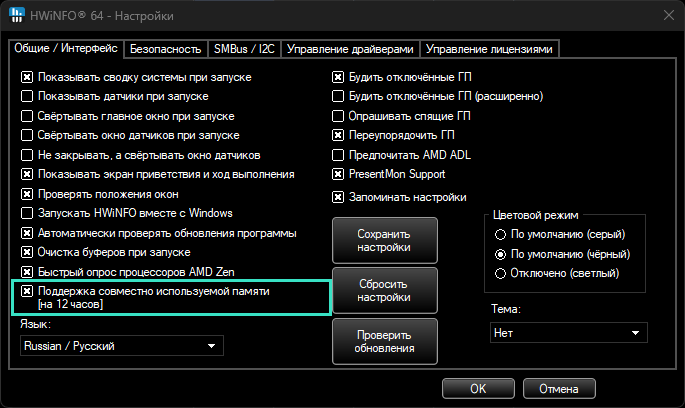
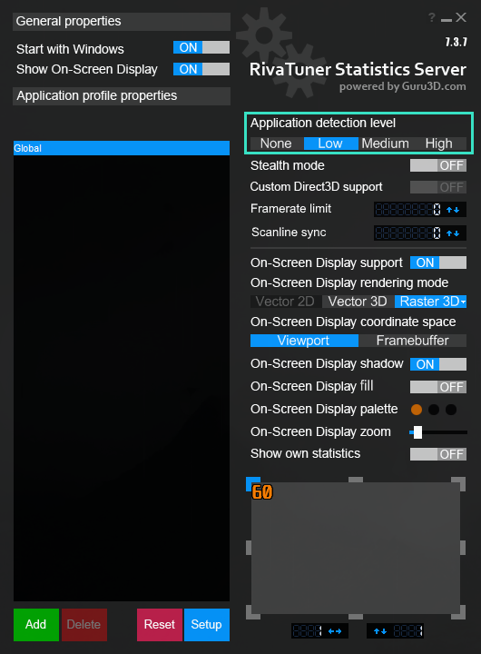

# PC HUD

Лёгкий монитор железа для второго (портативного) экрана. Берёт показания с
**HWiNFO** или **LibreHardwareMonitor** и рисует их в отдельном окне-приложении —
это не виджет на рабочем столе и не сайт в браузере, а обычное окно.


## Возможности

- CPU и GPU: температура (круговая шкала), нагрузка, частота, мощность.
- Ядра процессора: частота, нагрузка и температура каждого ядра, группы CCD,
  метка 3D V-Cache у X3D и метка «сон» у ядер, которые Windows усыпила.
- RAM и VRAM, температуры планок памяти, все диски (NVMe, SSD, HDD), сеть, FPS.
- Работает без настройки: датчики, основная видеокарта и объём видеопамяти находятся сами.
- Если HWiNFO не найден, HUD говорит, что сделать, и подключается сам, как только HWiNFO появится.
- Цветовое кодирование: спокойный → янтарный → красный по мере роста нагрузки/температуры.
- Один `.exe`, не требует установленного Python у конечного пользователя.

## Быстрый старт

Нужны три программы: HWiNFO (показания датчиков), RTSS (FPS в играх) и сам PC HUD.

1. **HWiNFO** — источник показаний. [Скачайте](https://www.hwinfo.com/download/) и установите, откройте **Настройки** и поставьте галку
   **Поддержка совместно используемой памяти** (в английской версии — **Shared Memory Support**).
   Оставьте HWiNFO запущенным с открытым окном датчиков. В бесплатной версии общая память
   отключается через 12 часов — тогда перезапустите HWiNFO.

   

2. **RivaTuner Statistics Server (RTSS)** — источник FPS, ставится вместе с
   [MSI Afterburner](https://www.msi.com/Landing/afterburner/graphics-cards) (галка RTSS в установщике).
   Оставьте его запущенным, а **Application detection level** — не ниже **Low**:
   при **None** RTSS не видит игру, и панель FPS останется пустой.

   

3. Скачайте **PC-HUD.exe** со страницы
   [последнего релиза](https://github.com/AlekseiVeretennikov/pchud/releases/latest)
   (раздел **Assets**), положите в любую папку и запустите. Python и установка не нужны,
   настраивать ничего не нужно: HUD сам найдёт датчики.
   Windows может показать «Система Windows защитила ваш компьютер», потому что программа
   не подписана: «Подробнее» → «Выполнить в любом случае».
4. Перетащите окно на портативный экран и разверните.

Вместо HWiNFO можно использовать **LibreHardwareMonitor**: Options → **Remote Web Server** → Run
(порт 8085). Если ни один источник не найден, HUD покажет демо-данные и подскажет, что включить.

## Запуск из исходников

На Windows с готовым окружением `.venv` достаточно дважды щёлкнуть по `start.bat`.
Вручную:

```bash
pip install -r requirements.txt
python -m backend.main                 # окно
python -m backend.main --fullscreen    # на весь экран
python -m backend.main --demo          # демо-данные (для проверки без железа)
python -m backend.main --list          # вывести все датчики и распознанные метрики
```

## Источники данных и античиты

Важно, если вы играете в игры с агрессивными античитами (Valorant/Vanguard, EAC, BattlEye):

- **HWiNFO** только читает уже опубликованные данные из общей памяти. Программа PC HUD
  ничего не внедряет в игры и не трогает их память — она лишь читатель. Это безопасный путь.
- **LibreHardwareMonitor** для доступа к датчикам поднимает kernel-драйвер (`WinRing0`).
  Такой драйвер исторически вызывает вопросы у некоторых античитов. Сам PC HUD при этом
  читает данные LHM по HTTP и драйвер в свой процесс не грузит — но если вы запускаете
  игру с жёстким античитом, надёжнее использовать **HWiNFO** как источник.

По умолчанию приоритет отдан HWiNFO именно по этой причине. Зафиксировать источник
можно в `config.json` полем `"source": "hwinfo"`.

## Настройка под свой ПК

Обычно не нужна. Чтобы что-то поменять, скопируйте `config.example.json` в `config.json`
рядом с программой.

- `source` — `"auto"`, `"hwinfo"`, `"libre"` или `"demo"`.
- `window.width` / `window.height` — размер под ваш портативный экран.
- `window.frameless: true` — окно без рамки (выглядит как чистая панель; тащится мышью).
- `poll_interval_ms` — период обновления (по умолчанию 1000 мс).
- `drives` — какие диски показывать, например `["C:", "Z:"]`; `null` — все диски с датчиком.
- `background` — анимированный фон: `"letter-glitch"` или `"none"` (без фона).
  Файлы фонов лежат в `web/backgrounds/`.
- `label_glitch` — редкая замена букв в подписях; `false` отключает эффект.

### Если какая-то метрика не определилась

Имена датчиков различаются между ПК. Посмотрите свои:

```bash
python -m backend.main --list
```

Найдите нужную строку (`sensor :: label`) и пропишите её точно в `metric_overrides`:

```json
{
  "metric_overrides": {
    "cpu_temp": { "sensor": "CPU", "label": "CPU Package" },
    "gpu_temp": { "sensor": "GPU", "label": "GPU Temperature" }
  }
}
```

Доступные ключи: `cpu_temp`, `cpu_load`, `cpu_clock`, `cpu_power`,
`gpu_temp`, `gpu_load`, `gpu_clock`, `gpu_power`, `vram_load`, `vram_used`,
`ram_load`, `ram_used`, `ram_avail`, `fps`.

Если HUD что-то определил неправильно, пришлите вывод `--list` автору: правило поиска
лучше поправить для всех, чем прописывать вручную.

## Сборка .exe

```bash
build.bat
```

Результат — `dist\PC-HUD.exe`, один файл. Нужен Python с окружением `.venv`; PyInstaller
скрипт поставит сам. Положите рядом `config.json`, если нужна своя настройка.

## Структура

```
pchud/
├── backend/
│   ├── main.py            запуск, окно pywebview, режимы --list/--demo
│   ├── manager.py         автовыбор источника и переподключение
│   ├── normalize.py       правила сопоставления датчиков -> метрики
│   ├── diagnose.py        подсказка, что не так с HWiNFO
│   ├── parking.py         спящие (припаркованные) ядра из Windows
│   └── sources/
│       ├── hwinfo.py      чтение Shared Memory
│       ├── rtss.py        FPS из RivaTuner Statistics Server
│       ├── libre.py       чтение веб-сервера LibreHardwareMonitor
│       └── demo.py        синтетические данные
├── web/                   HTML/CSS/JS дашборда
├── run_hud.py             точка входа для .exe
├── start.bat              запуск из исходников
├── build.bat              сборка dist\PC-HUD.exe
├── config.example.json
└── requirements.txt
```

## Лицензия

MIT, кроме `web/backgrounds/letter-glitch.js`: это перенос компонента LetterGlitch из
[React Bits](https://github.com/DavidHDev/react-bits) (© David Haz) под лицензией MIT + Commons Clause,
см. `web/backgrounds/letter-glitch.LICENSE.md`. Её нельзя продавать или распространять отдельно от приложения.
