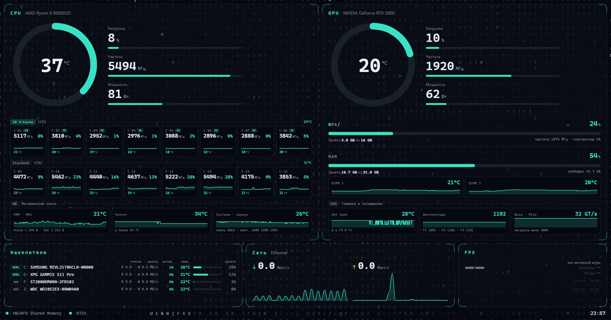
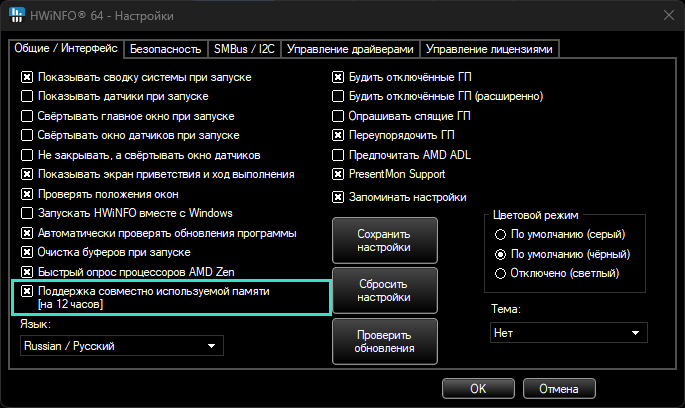
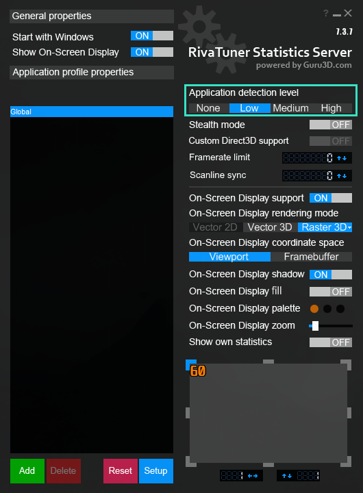

# PC HUD

Лёгкий монитор железа для второго (портативного) экрана. Берёт показания с
**HWiNFO** или **LibreHardwareMonitor** и рисует их в отдельном окне-приложении —
это не виджет на рабочем столе и не сайт в браузере, а обычное окно.



## Возможности

- CPU и GPU: температура (круговая шкала), нагрузка, частота, мощность.
- Ядра процессора: частота, нагрузка и температура каждого ядра, группы CCD,
  метка 3D V-Cache у X3D и метка «сон» у ядер, которые Windows усыпила.
- RAM и VRAM, температуры планок памяти, все диски (NVMe, SSD, HDD), сеть, FPS.
- Работает без настройки: датчики, основная видеокарта и объём видеопамяти находятся сами.
- Если HWiNFO не найден, HUD говорит, что сделать (не запущен, выключена общая память, запущен
  из zip-архива), и подключается сам, как только HWiNFO появится.
- Цветовое кодирование: спокойный → янтарный → красный по мере роста нагрузки/температуры.
- Анимированный фон в духе «Матрицы»: символьный дождь, из которого проступают слова
  (ошибки — красным).
- Заставка при запуске: «взлом» с бегущим логом, полосами прогресса и вскрытием ключа, затем
  ваше железо и ACCESS GRANTED. Есть короткий вариант.
- Три темы: **«Матрица»** (дождь символов и эффекты), **«Windows 11»** — спокойный системный
  вид в цветах Windows, и **«Приборная панель» (в работе)** — щит приборов в советском духе: стрелки,
  барабанные счётчики, самописцы и лампочки перегрева. Переключаются кнопкой **Темы** внизу окна.
- Кнопка **Настройки** внизу окна: цвета темы (циан, зелёная, тёмная, белая), яркость
  интерфейса и фона, слои фона, эффекты, заставка, монитор для запуска.
  Всё применяется сразу и сохраняется само.
- Один `.exe`, не требует установленного Python у конечного пользователя.

## Быстрый старт

Нужны три программы: HWiNFO (показания датчиков), RTSS (FPS в играх) и сам PC HUD.

1. **HWiNFO** — источник показаний. На [странице загрузки](https://www.hwinfo.com/download/)
   возьмите вариант **Installer** (файл вида `hwi64_860.exe`) и установите,
   затем откройте **Настройки** и поставьте две галки:
   - **Поддержка совместно используемой памяти** (в английской версии — **Shared Memory Support**);
   - **Показывать датчики при запуске** (**Show Sensors on Startup**).

   HWiNFO отдаёт данные, только пока открыто его окно **«Датчики»**. Вторая галка открывает его
   сама; без неё после каждого запуска HWiNFO нужно нажимать кнопку **«Датчики»**.
   Окно можно свернуть, но не закрывать. Удобно добавить ещё
   **Не закрывать, а свёртывать окно датчиков** и, по желанию,
   **Запускать HWiNFO вместе с Windows**.
   В бесплатной версии общая память отключается через 12 часов — тогда перезапустите HWiNFO.

   **Проще:** установите HWiNFO и в HUD нажмите **Настройки → HWiNFO → «Настроить HWiNFO»**.
   HUD сам поставит эти галки (Windows один раз спросит разрешение — HWiNFO лежит в
   Program Files), включит автозапуск и спрячет окна HWiNFO в трей. Дальше HUD сам запускает
   HWiNFO, если тот не работает, и перезапускает его, когда бесплатная версия через 12 часов
   отключает общую память. Для этого создаётся задание Планировщика «PC HUD - HWiNFO» без
   расписания — его запускает только HUD; убрать — кнопкой «Убрать задание» там же.

   > **Не запускайте HWiNFO прямо из zip-архива** (портативный вариант). Windows распаковывает
   > его во временную папку, настройки сохраняются туда и со временем пропадают — вместе
   > с галкой Shared Memory. Если нужен именно портативный, сначала распакуйте архив в
   > постоянную папку. Установленный HWiNFO хранит настройки в
   > `C:\Program Files\HWiNFO64\HWiNFO64.INI`, и кнопка **HWiNFO** в HUD находит его сама.

   

2. **RivaTuner Statistics Server (RTSS)** — источник FPS, ставится вместе с
   [MSI Afterburner](https://www.msi.com/Landing/afterburner/graphics-cards) (галка RTSS в установщике).
   Оставьте его запущенным, а **Application detection level** — не ниже **Low**:
   при **None** RTSS не видит игру, и панель FPS останется пустой.

   

3. Скачайте **PC-HUD.exe** со страницы
   [последнего релиза](https://github.com/AlekseiVeretennikov/pchud/releases/latest)
   (раздел **Assets**), положите в любую папку и запустите. Python и установка не нужны,
   настраивать ничего не нужно: HUD сам найдёт датчики.
   Windows может показать «Система Windows защитила ваш компьютер», потому что программа
   не подписана: «Подробнее» → «Выполнить в любом случае».
4. Перетащите окно на портативный экран и нажмите **F11** или кнопку **Весь экран** внизу окна.
   Вернуть обычное окно — F11, Esc или кнопка **Окно**; закрыть HUD — кнопка **Выйти**
   (второе нажатие подтверждает выход). HUD открывается на том мониторе,
   где его закрыли, или на выбранном в **Настройки → Окно → «Открывать на»**; чтобы он сразу
   открывался на весь экран, включите там же «Всегда открывать на весь экран».

Внизу окна надписи **HWiNFO** и **RTSS** — это кнопки. Если программа не запущена, щелчок
запустит её сам (Windows спросит разрешение администратора), а если она не установлена —
откроет страницу загрузки. Настройки HWiNFO и RTSS HUD не меняет: галки из шагов 1–2
ставятся один раз вручную.

### Что-то показывается неправильно?

Нажмите кнопку **Отчёт** внизу окна, справа от RTSS. На рабочем столе появится архив
`PC-HUD-report-….zip`, а Проводник сразу его покажет. Пришлите этот архив автору.
Внутри скриншот окна HUD и список датчиков HWiNFO. Это только названия железа и
показания, никаких личных данных.

Вместо HWiNFO можно использовать **LibreHardwareMonitor**: Options → **Remote Web Server** → Run
(порт 8085). Если ни один источник не найден, HUD покажет демо-данные и подскажет, что включить.

## Запуск из исходников

На Windows с готовым окружением `.venv` достаточно дважды щёлкнуть по `start.bat`.
Вручную:

```bash
pip install -r requirements.txt
python -m backend.main                 # окно
python -m backend.main --fullscreen    # на весь экран
python -m backend.main --demo          # демо-данные (для проверки без железа)
python -m backend.main --list          # вывести все датчики и распознанные метрики
```

## Источники данных и античиты

Важно, если вы играете в игры с агрессивными античитами (Valorant/Vanguard, EAC, BattlEye):

- **HWiNFO** только читает уже опубликованные данные из общей памяти. Программа PC HUD
  ничего не внедряет в игры и не трогает их память — она лишь читатель. Это безопасный путь.
- **LibreHardwareMonitor** для доступа к датчикам поднимает kernel-драйвер (`WinRing0`).
  Такой драйвер исторически вызывает вопросы у некоторых античитов. Сам PC HUD при этом
  читает данные LHM по HTTP и драйвер в свой процесс не грузит — но если вы запускаете
  игру с жёстким античитом, надёжнее использовать **HWiNFO** как источник.

По умолчанию приоритет отдан HWiNFO именно по этой причине. Зафиксировать источник
можно в `config.json` полем `"source": "hwinfo"`.

## Настройка под свой ПК

Обычно не нужна. Чтобы что-то поменять, скопируйте `config.example.json` в `config.json`
рядом с программой.

- `source` — `"auto"`, `"hwinfo"`, `"libre"` или `"demo"`.
- `window.width` / `window.height` — размер окна, если `window.maximized` равно `false`
  (по умолчанию HUD открывается развёрнутым).
- `window.frameless: true` — окно без рамки (выглядит как чистая панель; тащится мышью).
- `poll_interval_ms` — период обновления (по умолчанию 1000 мс).
- `drives` — какие диски показывать, например `["C:", "Z:"]`; `null` — все диски с датчиком.

Оформление удобнее менять кнопкой **Настройки** внизу HUD — она пишет сюда же:

- `theme` — тема оформления: `"matrix"` («Матрица»), `"windows"` («Windows 11»)
  или `"soviet"` («Приборная панель», в работе).
  Удобнее выбирать кнопкой **Темы** внизу HUD.
- `start_fullscreen` — сразу открываться на весь экран (`true`) или развёрнутым окном (`false`).
- `monitor` — на каком мониторе открываться: `"auto"` (где HUD закрыли) или имя монитора
  Windows вроде `"\\.\DISPLAY5"` — проще выбрать в «Настройки» → «Окно» → «Открывать на».
  Если выбранный монитор выключен, HUD попробует экран, где окно закрыли. Если и он
  недоступен, окно откроется на основном. В режиме «где закрыли» HUD помнит
  отключённый экран и при следующем запуске после подключения снова откроется на нём.
- `themes` — настройки каждой темы отдельно, например `"themes": {"matrix": {"palette": "green"}}`.

Настройки темы «Матрица» (`themes.matrix`):

- `palette` — цвет: `"cyan"` (циан), `"green"` (зелёная), `"dark"` (тёмная), `"light"` (белая)
  или `"custom"` (свой); `custom_color` — свой цвет, например `"#b06cff"`: остальные цвета HUD
  подбирает из него сам.
- `background` — анимированный фон: `"cipher-rain"` (символьный дождь с расшифровкой слов)
  или `"none"` (без фона).
- `bg_brightness` — яркость фона, от `10` до `100` (%).
- `bg_field`, `bg_drops`, `bg_words` — слои фона: поле тусклых символов, капли, слова.
- `label_glitch` — «шифрование» букв в подписях; `name_noise` — помехи в названиях CPU/GPU.
- `fx_rate` — как часто идут оба этих эффекта: `"low"` (редко), `"normal"`, `"high"` (часто).
- `boot_mode` — заставка: `"hacker"` (взлом), `"short"` (короткая) или `"off"`.

Настройки темы «Windows 11» (`themes.windows`):

- `mode` — `"system"` (как в Windows), `"dark"` или `"light"`.
- `accent` — цвет акцента: `"system"` (из «Параметры → Персонализация → Цвета»), `"blue"`,
  `"teal"`, `"green"`, `"purple"` или `"orange"`.

Настройки темы «Приборная панель» — в работе (`themes.soviet`):

- `case` — корпус: `"enamel"` (серо-зелёная эмаль),
  `"black"` (чёрная порошковая сталь),
  `"black-gloss"` (гладкая чёрная эмаль)
  или `"modules"` (светлые модули в графитовой раме).
- `digits` — цифры: `"drum"` (барабан), `"light"` (светлый барабан, как у счётчика электроэнергии),
  `"nixie"` (газоразрядные лампы, как ИН-14) или `"vfd"` (люминесцентный индикатор, как ИВ-11).
- `large_frame` и `small_frame` независимо задают вид крупных и малых табло.
  По умолчанию крупные используют накладную металлическую рамку (`"metal"`), а малые — утопленное окно (`"recessed"`).
- `overshoot` — стрелки с перелётом, как у настоящих приборов (`true`/`false`).
- `core_layout` — блок ядер: `"cassette"` (кассета с общей рамкой, по умолчанию) или `"separate"` (отдельные приборы).
- `lamps` — лампочки перегрева ЦП и ГП (жёлтая от 80 °C, красная мигает от 90, у ГП — от 88).
- `rec` — график: `"paper"` (ленточный самописец) или `"scope"` (осциллограф).
- `paper` — лента самописцев: `"bright"` (светлая) или `"dim"` (тусклая).
- `ink` — чернила самописцев: `"violet"`, `"red"`, `"green"` или `"blue"`.

До версии 0.1.8 эти ключи лежали прямо в корне `config.json` — такой файл HUD читает
по-прежнему и сам считает их настройками «Матрицы».

### Если какая-то метрика не определилась

Имена датчиков различаются между ПК. Посмотрите свои:

```bash
python -m backend.main --list
```

Найдите нужную строку (`sensor :: label`) и пропишите её точно в `metric_overrides`:

```json
{
  "metric_overrides": {
    "cpu_temp": { "sensor": "CPU", "label": "CPU Package" },
    "gpu_temp": { "sensor": "GPU", "label": "GPU Temperature" }
  }
}
```

Доступные ключи: `cpu_temp`, `cpu_load`, `cpu_clock`, `cpu_power`,
`gpu_temp`, `gpu_load`, `gpu_clock`, `gpu_power`, `vram_load`, `vram_used`,
`ram_load`, `ram_used`, `ram_avail`, `fps`.

Если HUD что-то определил неправильно, лучше пришлите автору архив с кнопки **Отчёт**:
правило поиска лучше поправить для всех, чем прописывать вручную.

## Сборка .exe

```bash
build.bat
```

Результат — `dist\PC-HUD.exe`, один файл. Нужен Python с окружением `.venv`; PyInstaller
скрипт поставит сам. Положите рядом `config.json`, если нужна своя настройка.

## Структура

```
pchud/
├── backend/
│   ├── main.py            запуск, окно pywebview, режимы --list/--demo
│   ├── manager.py         автовыбор источника и переподключение
│   ├── normalize.py       правила сопоставления датчиков -> метрики
│   ├── diagnose.py        подсказка, что не так с HWiNFO
│   ├── parking.py         спящие (припаркованные) ядра из Windows
│   ├── report.py          кнопка «Отчёт»: скриншот и датчики в .zip
│   ├── launcher.py        кнопки HWiNFO / RTSS: найти и запустить
│   ├── gpuinfo.py         объём VRAM из реестра Windows
│   └── sources/
│       ├── hwinfo.py      чтение Shared Memory
│       ├── rtss.py        FPS из RivaTuner Statistics Server
│       ├── libre.py       чтение веб-сервера LibreHardwareMonitor
│       └── demo.py        синтетические данные
├── web/                   HTML/CSS/JS дашборда
│   ├── themes/            темы оформления (registry.js — как их описывать)
│   └── fonts/             шрифт osifont для «Приборной панели» (LGPL 3 с исключением для шрифтов)
├── run_hud.py             точка входа для .exe
├── start.bat              запуск из исходников
├── build.bat              сборка dist\PC-HUD.exe
├── config.example.json
└── requirements.txt
```

## Лицензия

MIT, см. `LICENSE`. Шрифт osifont в `web/fonts/` — GNU LGPL 3 с исключением для шрифтов
(`web/fonts/README.txt`).
